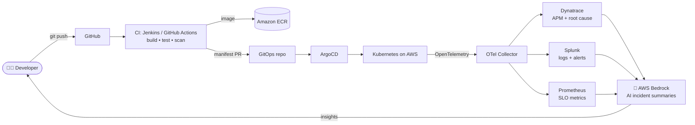

<div align="center">


<a href="https://git.io/typing-svg">
  
</a>

<p>
  <a href="https://www.linkedin.com/in/amiel-botbol-49430a93/"></a>
  <a href="https://www.credly.com/badges/bdff572e-93fc-4c58-ac90-b2dbd9c96172/public_url"></a>
  
  
</p>

</div>

---

## 👋 TL;DR for recruiters

> **Platform Engineer & SRE with an AWS architect's mindset.** I build the internal platform that lets R&D teams ship safely on their own: paved-road CI/CD, GitOps on Kubernetes, and end-to-end observability with OpenTelemetry, Dynatrace and Splunk. Now I'm wiring **generative AI (AWS Bedrock, Claude)** into that platform, so operations get smarter and developers move faster.

```yaml
amiel:
  roles: [Platform Engineer, Site Reliability Engineer, AWS Solutions Architect]
  i_build:
    - Internal developer platforms and golden paths (self-service, secure by default)
    - Kubernetes + GitOps delivery with ArgoCD, Jenkins and GitHub Actions
    - Observability with OpenTelemetry, Dynatrace, Splunk and Prometheus
    - GenAI features and AI-assisted operations on AWS Bedrock
  i_care_about: [Developer experience, SLOs and error budgets, Cost-aware cloud design, Automation over toil]
  looking_for: R&D, Platform, SRE or Cloud Architecture teams that ship
```

<!-- TIP: add 2-3 quantified wins here. Numbers beat adjectives with recruiters, e.g.
- ⚡ Cut CI pipeline time from 40 min to 12 min by parallelising Jenkins stages
- 📉 Reduced MTTR by X% after rolling out OpenTelemetry tracing into Dynatrace
- 💸 Cut AWS spend X% with right-sizing, Graviton and spot capacity
- 🚀 Moved N services to EKS with ArgoCD GitOps, zero downtime
-->

## 🧭 What I bring to an R&D team

<table>
  <tr>
    <td width="50%" valign="top">
      <h3>🏗️ Platform Engineering</h3>
      <ul>
        <li>Internal developer platform and <b>golden paths</b>: from repo to production in self-service</li>
        <li><b>Kubernetes</b> and <b>Docker</b> as the runtime, <b>ArgoCD</b> GitOps as the delivery contract</li>
        <li>Reusable <b>CI/CD</b> templates in Jenkins and GitHub Actions</li>
        <li>Platform as a product: docs, guardrails, and developer experience first</li>
      </ul>
    </td>
    <td width="50%" valign="top">
      <h3>🛡️ Site Reliability Engineering</h3>
      <ul>
        <li><b>SLOs, SLIs and error budgets</b> that drive release decisions</li>
        <li>Incident response, on-call and <b>blameless postmortems</b></li>
        <li>Toil reduction through automation (Python, Bash)</li>
        <li>Capacity planning and resilience on Linux / RHEL</li>
      </ul>
    </td>
  </tr>
  <tr>
    <td width="50%" valign="top">
      <h3>☁️ AWS Solutions Architecture</h3>
      <ul>
        <li>Designs aligned to the <b>AWS Well-Architected</b> pillars</li>
        <li>Multi-account, least-privilege IAM, keyless CI via <b>OIDC</b></li>
        <li>High availability across AZs, with cost and performance in mind</li>
        <li>Containers on AWS, from build to observability</li>
      </ul>
    </td>
    <td width="50%" valign="top">
      <h3>🔭 Observability</h3>
      <ul>
        <li><b>OpenTelemetry</b> as the vendor-neutral standard for traces, metrics and logs</li>
        <li><b>Dynatrace</b> for full-stack APM and AI-driven root cause</li>
        <li><b>Splunk</b> for log analytics, dashboards and alerting</li>
        <li><b>Prometheus</b> for Kubernetes and service metrics</li>
      </ul>
    </td>
  </tr>
  <tr>
    <td colspan="2" valign="top">
      <h3>🤖 Generative AI on the platform</h3>
      <ul>
        <li><b>AWS Bedrock</b> and the <b>Claude</b> API to add LLM features to products and to internal tooling</li>
        <li>AI-assisted operations: summarising incidents, logs and change history so engineers act faster</li>
        <li>Agentic development with <b>Claude Code</b>; this very page is maintained by an AI pipeline (see below)</li>
      </ul>
    </td>
  </tr>
</table>

## 🗺️ How I design a platform



## 🛠️ Tech stack

<p align="center">
  
  <br/>
  
</p>

<p align="center">
  
  
  
  
  <br/>
  
  
  
  
</p>

## 🤖 Live, AI-generated: what I'm building right now

> Every Monday a GitHub Action reads my latest public activity and asks an LLM to summarise it, on **AWS Bedrock** (keyless, via OIDC) or the **Claude API**. Platform thinking applied to my own profile: automated, observable, zero toil. Source: [`scripts/update_readme.py`](scripts/update_readme.py) · [`workflow`](.github/workflows/update-readme.yml)

<!-- AI-SUMMARY:START -->
Currently focused on **platform engineering with generative AI**: building self-service delivery on **Kubernetes** and **AWS**, instrumenting services with **OpenTelemetry**, and adding LLM features through **AWS Bedrock** and **Claude Code**.
<!-- AI-SUMMARY:END -->

<details>
<summary><b>⚡ Recent public activity</b> (auto-updated)</summary>

<!-- ACTIVITY:START -->
- Profile README upgraded with an AI-generated weekly summary
<!-- ACTIVITY:END -->

</details>

## 📊 GitHub at a glance

<p align="center">
  
  
</p>

<p align="center">
  
</p>

<p align="center">
  
</p>

## 📫 Let's build something reliable

Hiring for **Platform Engineering, SRE, Cloud Architecture or R&D**? I'd love to hear what your team is building and where it hurts.
The fastest way to reach me is **[LinkedIn](https://www.linkedin.com/in/amiel-botbol-49430a93/)**.


