  

  

<a href="https://www.linkedin.com/in/amiel-botbol-49430a93/"><b>LinkedIn</b></a> &nbsp;·&nbsp; <a href="https://www.credly.com/badges/bdff572e-93fc-4c58-ac90-b2dbd9c96172/public_url"><b>AWS certification</b></a>

This profile is code: rendered from <a href="profile/profile.toml">profile.toml</a> by a GitHub Action, and narrated weekly by AI on AWS Bedrock.

